<!-- Old Money palette: navy #0B1F3A · gold #C9A227 · bone #F5F0E1 · white.
     Rule: gold only ever sits on navy. Section titles ship light/dark versions
     because they sit directly on GitHub's page background. -->

  

 

<!-- ============ ABOUT ME ============ -->

  <picture>
    <source media="(prefers-color-scheme: dark)" srcset="assets/title-about-dark.svg" />
    
  </picture>

  <!-- TODO: two or three short sentences. Who you are, what you build, what you're after. -->

 

<!-- ============ STACK ============ -->

  <picture>
    <source media="(prefers-color-scheme: dark)" srcset="assets/title-stack-dark.svg" />
    
  </picture>

  
  
  
  
   
  
  
  
  
  
  
   
  
  
  
  
  

 

<!-- ============ GITHUB STATS ============ -->

  <picture>
    <source media="(prefers-color-scheme: dark)" srcset="assets/title-stats-dark.svg" />
    
  </picture>

  
  

 

<!-- ============ CONTRIBUTIONS ============ -->

  <picture>
    <source media="(prefers-color-scheme: dark)" srcset="assets/title-contrib-dark.svg" />
    
  </picture>

  <picture>
    <source media="(prefers-color-scheme: dark)" srcset="https://raw.githubusercontent.com/santiagodie/santiagodie/output/github-snake-dark.svg" />
    
  </picture>

 

  

